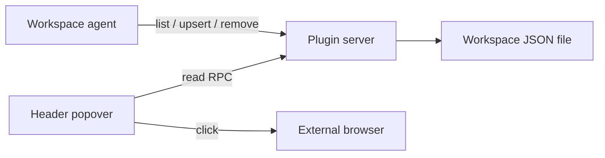

# Paseo pins: useful workspace links within reach

Give users a dependable place to find the resources relevant to their current workspace. Agents maintain a short list of named links, and users open that list from a Pins button in the workspace header. The first version uses external HTTP(S) links and a small persistent store, with no changes to Paseo itself.

Status: implemented and installed on the local Paseo 0.15.2 daemon. Focused validation passed; product review and comprehensive validation are pending. See [VALIDATION.md](VALIDATION.md) for evidence and remaining checks.

## In this plan

- [First-version experience](#first-version-experience) — A workspace popover with clickable links and no editing controls.
- [Agent behavior](#agent-behavior) — Three tools and explicit guidance for maintaining useful pins.
- [Storage and implementation](#storage-and-implementation) — A released-version baseline and a persistent store shared by agents in each workspace.
- [Validation and review](#validation-and-review) — Focused checks followed by product review before comprehensive validation.
- [Paseo capabilities and later additions](#paseo-capabilities-and-later-additions) — Confirmed extension points, limitations, and the next possible features.

## First-version experience

The user opens a workspace's Pins popover and clicks a resource. Agents alone create, update, and remove entries. This is a curated list of current resources, not a history of everything an agent has produced.

Agreed scope:

- One list per Paseo workspace, shared by its agents.
- A Pins button in the workspace controls, opening a dropdown/popover.
- HTTP(S) links only, opening externally in v1.
- Sidebar access, formatted chat summaries, file links, and explicit Paseo-browser opening are deferred.
- A newer Paseo release is acceptable if useful, but this scope does not require unreleased APIs.

```text
Workspace controls                         [ Pins ▾ ]
                                           ┌──────────────────────────┐
                                           │ Pins                     │
                                           │ Dev preview           ↗  │
                                           │ preview.example.test     │
                                           │                          │
                                           │ Review changes        ↗  │
                                           │ github.com/team/app/…    │
                                           └──────────────────────────┘
```

Each row shows a title and a muted destination; the entire row is clickable. Keep creation order stable when editing a pin. No sorting controls, categories, descriptions, search, badges, or drag-and-drop are needed initially.

Keep the button available when empty, with “No pins yet. Ask an agent to pin a useful link.” Distinguish loading, an empty list, and a failed read. Show a retry action for failures. Display link-opening errors rather than silently dropping them. Close the popover after a successful opening attempt.

Use Paseo's header-button/popover contribution and theme tokens. Paseo adapts the header entry into the workspace menu on compact layouts and presents popover content in a sheet. Other supported surfaces include sidebar rows, workspace panels, screens, composer contributions, file panels, and timeline renderers. [Plugin reference](https://paseo.sh/docs/plugins/reference#header-buttons)

## Agent behavior

Agents should maintain a small set of links that help the user inspect, review, or use the work. Preserve valid resources unless there is a concrete reason to replace or remove them.

Expose these tools through `defineAgentTool` and `agent.open.before`:

| Tool | Input | Result |
| --- | --- | --- |
| `pins_list` | None | Current workspace's pins |
| `pins_upsert` | `key`, `title`, `url` | Created, updated, or unchanged pin |
| `pins_remove` | `key` | Removed pin, or already absent |

The workspace comes from the authenticated calling agent's context, never a model-supplied workspace ID. Refuse calls without a workspace. Attach tools to workspace agents where the provider's Paseo-tool configuration permits them. Names are plugin-specific to reduce collisions.

Use stable semantic keys such as `dev-preview` or `review-pr`. Upserting the same key replaces its title and destination; it does not add a second entry. Exact no-op updates do not change timestamps. Removing a missing key succeeds without changing anything. Tools return structured results plus concise model-readable text.

Paseo supplies calling-agent identity to attached tools and supports adding tools at session open. A creation hook can change saved agent configuration; session-open hooks cannot change the system prompt. [Hook contracts](https://paseo.sh/docs/plugins/hooks#attach-tools-to-agents)

### Guidance delivery

Use tool descriptions as the universal baseline, and append a short instruction block to new agents' existing `systemPrompt` in `agent.create.before`. Preserve existing instructions and avoid appending the block twice. The SDK defines `systemPrompt` as additional system/developer instructions. [SDK configuration](https://paseo.sh/docs/sdk/reference#clientagents)

Proposed instruction block:

> When the pins tools are available, keep workspace pins useful and current. When your work produces or changes a resource the user should access, inspect the existing pins and add or update the relevant link. Prefer the current preview, staging environment, review request, example, or deliverable. Reuse an existing key for the same purpose. Remove links you know are obsolete, expired, or superseded. Do not remove another agent's useful resource merely because it is unrelated to your task, and do not treat age alone as expiry. Use reachable URLs, without embedded credentials. Before handing work back, reconcile pins when the resources changed; otherwise leave them alone.

Include the essential policy in tool descriptions too, so existing agents receive guidance when their tools refresh. They will not retroactively receive the new-agent prompt block. Document that distinction and verify both cases. Avoid automatic follow-up turns, background curators, or mandatory link-checking requests.

A separate skill is optional later if the workflow needs longer examples. The v1 policy should travel with the plugin rather than require users to install another artifact.

## Storage and implementation

Use plugin-owned JSON files for v1, with all mutations handled by the plugin server. This keeps the data durable without depending on unreleased workspace metadata or putting generated state into the user's repository.

The local CLI and bundled SDK are 0.15.2. Inspection found header popovers, attached tools, and external-link opening, but no workspace `setMetadata`. The latest stable release checked, [0.15.4](https://github.com/getpaseo/paseo/releases/tag/v0.15.4), also lacks `setMetadata` in its client source. Target 0.15.2 or later initially and confirm the actual daemon and app versions when installing.

### Record and persistence rules

Use a versioned document `{ version: 1, workspaceId, pins: [...] }`. Each pin contains `key`, `title`, `url`, `createdAt`, and `updatedAt`. Server code owns timestamps.

Validate keys against `[a-z][a-z0-9-]{0,63}`, trim nonempty titles with a 120-character limit, and require absolute HTTP(S) URLs with a 4096-character limit. Reject URLs with embedded username/password fields. Preserve the supplied URL's path, query, and fragment; do not deduplicate distinct URLs automatically or fetch destinations to validate them.

Default storage: `~/.local/share/paseo-pins/workspaces/<sha256(workspaceId)>.json` on the daemon machine. Permit an absolute `PASEO_PINS_DATA_DIR` override for custom deployments. Workspace UUIDs identify records; paths and display names do not. Store and verify the original workspace ID inside each document. Use one active installation of this plugin per daemon for v1.

Serialize mutations per workspace, read the latest document inside that queue, write a temporary sibling file, and atomically rename it. Updates to different keys must not overwrite one another. For competing updates to the same key, the last successfully committed operation wins. Wait for in-flight writes during cleanup. Return success only after persistence succeeds.

A missing file means an empty list. Invalid JSON or an unsupported schema version is an error; preserve the file instead of resetting it. Retain data across plugin reloads, restarts, disablement, and uninstall. Archiving a workspace does not erase its pins; automatic garbage collection is deferred. Recreating a workspace with a new ID starts a new list.

### Client and server responsibilities



Keep schemas and RPC contracts in `shared/`, filesystem access and tools in `server/`, and the popover and registration lifecycle in `client/`. Entries remain `index.server.ts` and `index.client.tsx`.

Register a header button for each workspace observed through the SDK; reconcile registrations after reconnect and remove owned subscriptions on cleanup. The popover obtains its workspace ID from Paseo's supplied context.

Expose a read-only `pins.list` RPC to the client. Use TanStack Query with a workspace-scoped key, fetch on opening, and refresh every two seconds while the popover is mounted. Stop polling on close. This gives prompt updates without requiring a newer plugin subscription API. During a transient failure, retain previously loaded rows with a visible stale/error indication.

Use `ExternalLink` or `openExternalUrl` for HTTP(S) destinations. On desktop this targets the system browser; browser clients open a new tab, and mobile delegates to the OS. [External-link behavior](https://paseo.sh/docs/plugins/reference#external-links-and-workspace-browsers)

Local preview URLs must be reachable from the user's device. In particular, a remote daemon's `localhost` is not the user's desktop. Agent guidance should prefer an existing forwarded or published URL; v1 does not create tunnels or expose servers.

## Validation and review

Show the working popover for product review after focused checks. Comprehensive validation stays explicitly pending until the user approves the feature's behavior and presentation, as required by the supplied AGENTS.md instructions.

Before product review, typecheck and run focused tests covering workspace isolation, repeated upserts, removal, concurrent writes, invalid URLs, malformed stored data, and persistence failures. Inspect the actual popover in wide and compact layouts and both light and dark themes. Run an agent interaction that adds, updates, lists, and removes pins.

Acceptance scenarios:

1. Two agents in one workspace see the same list; a different workspace sees its own list.
2. Updating `dev-preview` changes one row without duplication or reordering.
3. An open list reflects a committed change within the polling interval plus request latency.
4. Pins survive plugin reload and daemon restart; failed writes never report success.
5. Clicking opens the expected external HTTP(S) destination. Empty, loading, offline, and corrupt-storage states are distinguishable.
6. A newly created agent receives the maintenance policy; existing agents receive the tool descriptions after session refresh.

After product approval, complete the required checks, exercise restart/reconnect behavior in an isolated test daemon, and verify supported client/provider combinations. Do not restart the active daemon carrying the development conversation for this test. Merge and publication require separate authorization.

## Paseo capabilities and later additions

Keep later features separate so v1 remains a small, useful plugin.

| Addition | Current finding and proposed next step |
| --- | --- |
| Built-in browser | Navigation is exposed to screens/panels, but header popover props lack it. Add a supported popover navigation capability before implementing the user's preferred in-app-first behavior. |
| Workspace files | No direct `openFile` method was found in the inspected public navigation contract. Markdown can inherit host link handling; verify workspace context and viewer targeting before promising file pins. |
| Sidebar | Reuse the list component in a sidebar contribution, explicitly choosing which workspace its entry represents. |
| Chat summaries | Timeline contributions can render pin changes. Decide between tool-result transformation and an aggregated post-turn row, including history persistence. |
| Native workspace storage | Current development docs describe durable JSON workspace metadata via `setMetadata`. Reconsider after that API ships in the chosen release; migrate existing files explicitly. |

The current [workspace metadata documentation](https://paseo.sh/docs/plugins/hooks#metadata) confirms the intended native storage facility. Host/device settings and per-tab state serve different purposes; neither is the chosen source of truth for v1 pins.

The inspected [popover props](https://github.com/getpaseo/paseo/blob/main/packages/plugin/src/client/buttons.ts) explain the browser-opening limitation. This plan avoids private app imports or route construction to work around it.
