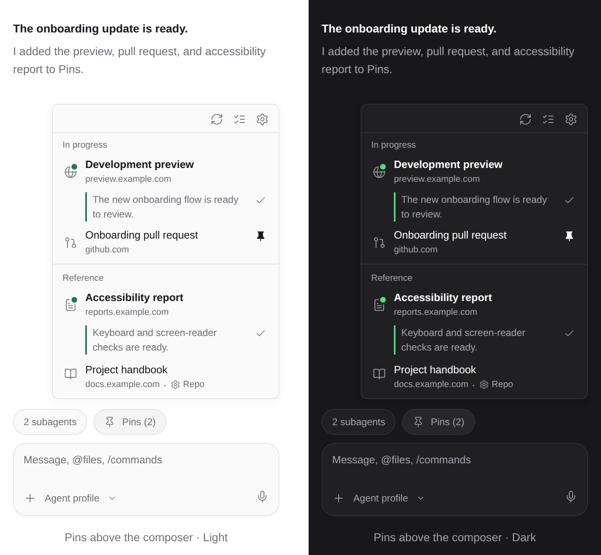

<h1 align="center">Pins</h1>

<p align="center">Useful workspace resources, kept current by your agents.</p>

<p align="center">
  <a href="assets/menu-gallery.png"></a>
</p>

<p align="center">
  <a href="assets/chat-summary.png"></a>
  <br><sub>Updates in chat</sub>
</p>

<p align="center"><sub>Current components with sample data in a web preview. Click an image to enlarge.</sub></p>

- **Maintained by agents:** Agents add useful links, update destinations, and prune obsolete resources as work progresses.
- **Find and refresh:** Manually trigger an agent which discovers resources from recent work.
- **Updates with context:** Pins get updated with a short message and a notification dot when there are meaningful changes.
- **Updates in chat:** Updates to pins appear in the chat log after agent turns.
- **Keep what matters:** Protect individual pins from agent removal and organize related resources into sections.
- **Shared with your project:** Define repository-owned links in [`.paseo/pins.json`](docs/configuration.md).
- **Across devices:** Workspace pins and read state follow you across connected devices.

## Get started

Requires Paseo **0.15.4 or later** on both the daemon and app. Enable plugins in **Settings → Plugins**, then install from this repository:

```sh
paseo plugin add git:agaman/paseo-pins
```

Enable **Paseo tools** under **Settings → your host → Agents** so agents can manage pins. New or reopened agent sessions receive the tools and guidance.

Open **Pins** above the chat composer, beside Tasks and Subagents, on desktop or mobile. Press **Find pins** to discover useful links from recent work, or ask your agent to add one. Links open in your device's external browser.

## Settings

The menu's gear opens **Pins settings**.

### Agent profile

Choose which agent runs Find and Refresh pins. **Automatic** uses the workspace agent's provider and model, falling back to an available provider when needed. Select a saved profile to use it across this host's workspaces.

## Development

Requires Node.js **22 or later**. In a clone of this repository:

```sh
npm ci
npm run hooks:install
npm run check
```

Install the checkout with a separate development ID. If the GitHub version is installed, disable it first:

```sh
paseo plugin disable paseo-pins # Only if already installed
paseo plugin install "$PWD" --id paseo-pins-dev
```

Keep only one Pins installation enabled at a time: both use the same workspace pin data. After editing, run `paseo plugin reload paseo-pins-dev`.

To switch back to the installed GitHub version:

```sh
paseo plugin disable paseo-pins-dev
paseo plugin enable paseo-pins
```

The pre-commit hook runs lint, formatting, type checks, unused-code and duplicate-code checks, and tests.

## Contributing

[Report a bug or suggest an improvement](https://github.com/agaman/paseo-pins/issues). The [contribution guide](https://github.com/agaman/paseo-pins/blob/main/CONTRIBUTING.md) covers the source layout, validation, and screenshot tooling.

## License

[MIT license](LICENSE).
