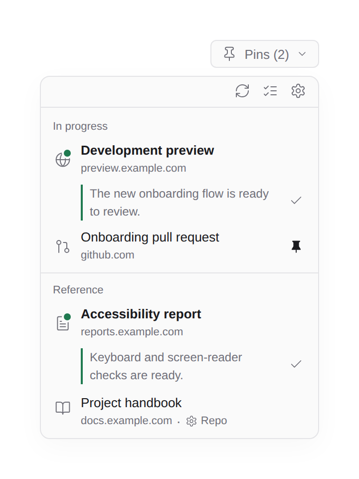
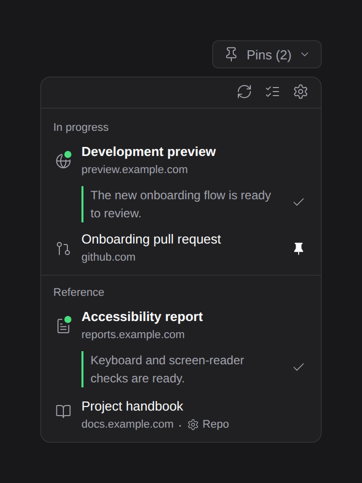
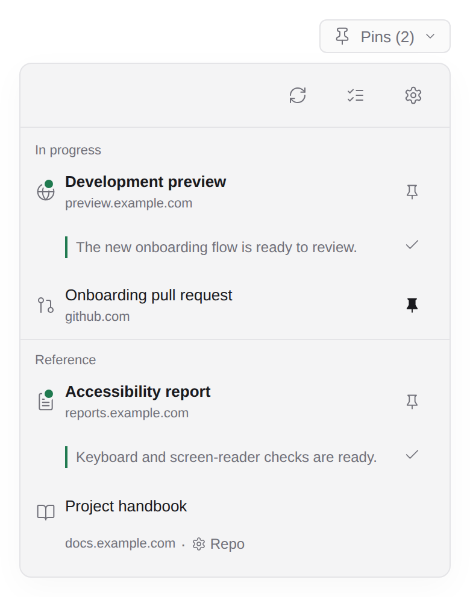
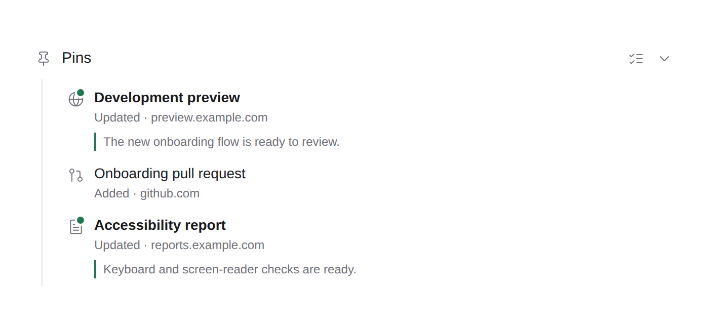

<h1 align="center">Pins</h1>

<p align="center">Useful workspace resources, kept current by your agents.</p>

<p align="center">
  <a href="assets/menu-light.png"></a>
  <a href="assets/menu-dark.png"></a>
  <a href="assets/menu-compact.png"></a>
</p>

<p align="center">
  <a href="assets/chat-summary.png"></a>
</p>

<p align="center"><sub>Light, dark, and compact menus · Updates in chat<br>Current components with sample data in a web preview. Click an image to enlarge.</sub></p>

- **Your work, within reach:** Previews, pull requests, documents, and deliverables in each [Paseo](https://paseo.sh) workspace's menu.
- **Maintained by agents:** Agents add useful links, update destinations, and prune obsolete resources as work progresses.
- **Find and refresh:** A separate agent discovers resources from recent work and keeps the list current.
- **Updates with context:** Meaningful changes carry a short message and an unread dot. Additions and updates also appear in chat.
- **Keep what matters:** Protect individual pins from agent removal and organize related resources into sections.
- **Shared with your project:** Define repository-owned links in [`.paseo/pins.json`](docs/configuration.md). Workspace pins and read state follow you across connected devices.

## Get started

Requires Paseo **0.15.4 or later** on both the daemon and app. Enable plugins in **Settings → Plugins**, then install from this repository:

```sh
paseo plugin add git:agaman/paseo-pins
```

Enable **Paseo tools** under **Settings → your host → Agents** so agents can manage pins. New or reopened agent sessions receive the tools and guidance.

Open **Pins** in the workspace header, or the workspace menu on mobile. Press **Find pins** to discover useful links from recent work, or ask your agent to add one. Links open in your device's external browser.

## Settings and data

The menu's gear opens **Pins settings**. Use the workspace agent's model automatically, or choose a saved profile for this host.

Find and refresh send recent conversation context and requested repository excerpts to the selected provider, using its normal allowance or billing. Pins and read state live on your daemon; uninstalling leaves that data in place. See [help and troubleshooting](docs/help.md) for details.

## Development

Requires Node.js **22 or later**. In a clone of this repository:

```sh
npm ci
npm run hooks:install
npm run check
paseo plugin install "$PWD"
```

After editing, run `paseo plugin reload paseo-pins`. The pre-commit hook runs lint, formatting, type checks, unused-code and duplicate-code checks, and tests.

## Contributing

[Report a bug or suggest an improvement](https://github.com/agaman/paseo-pins/issues). The [contribution guide](https://github.com/agaman/paseo-pins/blob/main/CONTRIBUTING.md) covers the source layout, validation, and screenshot tooling. See the [roadmap](https://github.com/agaman/paseo-pins/blob/main/docs/roadmap.md) for deferred ideas.

## License

[MIT license](LICENSE).
