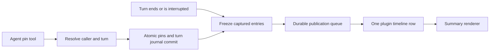

# See each turn’s useful resources in chat

> **Behavior update (2026-11-13):** the user rejected replaying old summaries into current chat. This supersedes the recovery/backfill behavior below: never replay a summary recorded as published. Retry undelivered summaries for five minutes after completion is recorded, checking for existing rows before appending. Unfinished summaries are eligible for recovery only within five minutes of their start time. Use the normal **Pins** heading. Expired entries remain in the journal without automatic publication.


Show the pins an agent adds or meaningfully updates directly below its turn, so the user can review the result without opening the Pins menu. One compact block preserves the destinations captured in that turn and shares acknowledgment with the workspace list.

**Status:** implemented and reviewed; the comprehensive repository gate and composed browser previews pass. Native-device verification remains pending. The product decisions below are agreed. The design is in **Pins · After-turn summaries** (`design/pin-chat-summaries`). Implementation requires Paseo **0.15.4 or newer** on the daemon and clients; no Paseo source changes are proposed or authorized.

## In this plan

- [Experience](#experience) — One expandable block, historical links, and shared read state.
- [Supported integration](#supported-integration) — Use the released timeline API and plugin-owned persistence.
- [Recording and publishing](#recording-and-publishing) — Attribute changes to a turn and recover publication without duplicating it.
- [Rendering and acknowledgment](#rendering-and-acknowledgment) — Keep historical resources stable while attention changes.
- [Validation](#validation) — Prove persistence and concurrency before completing the feature.

## Experience

The block contains committed resources from the conversation that changed them. It is part of chat history, not another view of the current pin list.

```text
Agent’s final reply…

[pin] Pins                                [✓≡] [⌄]
  │ [icon] Development preview
  │        Added · preview.example.test
  │ [icon●] Review changes
  │         Updated · github.com
  │         Ready for another review.
  │ [icon] Mobile layout notes
  │        Added · docs.example.test
  │ Show all 5 ▾
```

Agreed behavior:

- Include newly created pins and updates explicitly flagged for attention. Routine edits and removals alone do not create a summary. Show no empty block.
- Consolidate repeated changes to one pin during a turn. A new pin edited again stays “Added”; an existing pin flagged repeatedly appears once as “Updated.” Omit a pin removed before the turn ends.
- Initially show up to three entries. **Show all N** expands the rest; **Show less** restores the compact view. Expansion is local UI state and does not acknowledge anything.
- Each link retains its captured title, type/icon, destination, and attention token. Later edits and deletion do not rewrite the block or redirect its links. This preserves a URL, not the contents of its destination.
- Opening a link acknowledges only its captured update after opening succeeds. The block’s `ListChecks` button, tooltip **Mark as read**, acknowledges all eligible captured updates, including collapsed entries. It does not clear other workspace updates.
- Use the existing dot over the icon for unread updates. Clear it when that update is read, superseded, or removed from the current list. Keep historical rows visible; disable the block action when no captured updates remain eligible.
- Canceled and failed turns still publish committed changes with **Turn interrupted**. Child agents publish in their own conversation, not additionally in the parent.

The current design follows Paseo’s command groups: a full-width plain heading with right-side actions and collapse chevron, indented rows beside a vertical rule, and no enclosing card. Collapse hides the entire body without changing read state. The earlier canvas illustrates the original card treatment. The implementation retains the plugin’s resource icons, Added/Updated labels, and update messages, required for new notifications and optional for legacy entries. The selected thin accent line uses the configured theme accent; messages use foregroundMuted and wrap fully, up to the 240-character input limit. It includes desktop and mobile, light and dark, expanded, interrupted, historical, and acknowledgment-error states. The no-change artboard shows the reply with no block.

## Supported integration

Use a server-published plugin timeline row and a registered client renderer. Do not rewrite assistant prose or replace ordinary tool rows.

| Capability | Confirmed basis |
| --- | --- |
| Turn completion and interruption | `agent.turn.before` / `agent.turn.after`, including outcome and nullable turn ID |
| Caller attribution | `AgentToolContext.agent.id` and `.workspaceId` |
| Current turn fallback | Public SDK agent `refresh()` and `activeTurn.turnId`; never `reload()` to inspect state |
| Chat row | `paseo.agents.ref(agentId).timeline.append(...)` |
| Idempotent identity | Reuse one plugin-local row ID per workspace/agent/turn |
| Custom rendering | `client.addTimelineRenderer(...)` with a versioned Zod payload |
| Shared attention | Existing pin attention tokens, workspace query, and acknowledgment store operation |

Implementation is tested against released 0.15.4. Its shipped daemon contains durable timeline code, but the isolated restart test established that bootstrap does not connect that store to the running agent manager. The earlier source-only assumption that 0.15.4 persisted these rows was incorrect. Do not rely on the host to retain plugin rows across a daemon restart.

The plugin journal preserves historical entries and restores missing rows through the public append API. After a restart, recovered summaries can appear later in the conversation; they are explicitly labeled **Recovered pin updates** with the original turn time. This is a working-feature review limitation, not a request to change Paseo. The manifest minimum reflects the runtime tested, not a guarantee of host timeline durability.

The renderer kind is `turn-summary`: the app rejects dotted renderer kinds even though the append API accepts them. Keep the summary journal and publication status to recover failed appends and process interruptions. The development daemon has since been upgraded to 0.15.4 by the user. Additional tests use an isolated 0.15.4 instance.

References: [plugin timeline rows](https://paseo.sh/docs/plugins/reference#append-a-timeline-row-from-the-daemon), [0.15.4 timeline implementation](https://github.com/getpaseo/paseo/blob/v0.15.4/packages/server/src/server/agent/agent-manager.ts), [0.15.4 tool context](https://github.com/getpaseo/paseo/blob/v0.15.4/packages/plugin/src/server/agent-tools.ts). Only the public plugin/SDK contracts are used by this plugin; host source was read to verify behavior.

## Recording and publishing

Commit the pin mutation and its summary candidate together. A successful pin write must not be followed by a separate, fallible “remember this change” write.



### Identity and attribution

Resolve turn identity at tool entry, before waiting for the workspace mutation queue. Maintain a per-agent turn map from lifecycle events; recover missing state using the public agent snapshot. The SDK tool context does not itself contain a turn ID. Never infer ownership from “the most recent workspace change,” since several agents can share a workspace.

Capture immutable mutation provenance `{agentId, workspaceId, turnId}`. Serialize turn lifecycle transitions and mutations so the end event waits for that turn’s already-started writes. A duplicate end event must finalize the same record, and a late event must not finalize a newer turn. If the API supplies no usable turn ID, reject a changing operation before writing with a clear retryable error rather than silently recording the wrong turn. Reads remain available. Verify this path with the supported providers in the implementation checkpoint.

Use a deterministic row ID derived from workspace, agent, and turn. Add a stable `instanceId` to each pin lifetime in the storage migration. Removing and recreating a key gets a new instance; this prevents consolidation or end-of-turn presence checks from confusing the replacement with the original.

### Durable journal and consolidation

Extend the workspace document to version 3 with pin instance IDs and turn summary records. Migrate existing pins without changing their attention/read state, and do not backfill summaries for old turns. Keep using one queued atomic rename for workspace changes, preserving the current failed-write and batch all-or-nothing guarantees.

A turn record contains its identity, start/end metadata, outcome, ordered candidates, final immutable entries, and publication state. Each candidate records its instance ID, key, Added/Updated kind, title, URL, type, latest qualifying attention token, and optional reason. New pins start read and still create Added entries; their token is null unless an explicit update later in the turn creates attention. Null-token entries never acknowledge future updates.

Within a turn:

1. Add a candidate only when a mutation creates a pin or issues a fresh attention token. Retrying an already-consumed notification ID cannot add another candidate.
2. Later successful edits by the same turn update that candidate’s resource snapshot, even when the later edit is routine. Keep the latest meaningful-update reason/token. Preserve first qualifying-change order.
3. A removal suppresses that instance. At finalization, also omit candidates whose instance no longer exists. A different agent’s edits do not become this agent’s historical snapshot.
4. Freeze final entries when the turn ends. After freezing, current pin changes affect only eligibility for acknowledgment, never the stored links or labels.

The workspace queue coordinates finalization with concurrent mutations. Once published, a summary is retained independently of live pin removal. No automatic history expiry or pruning is included in this project; a later retention policy must not silently break old links.

### Publication and recovery

Append a small row, for example:

```json
{
  "type": "plugin",
  "id": "pins-turn-<stable digest>",
  "kind": "turn-summary",
  "version": 1,
  "data": { "workspaceId": "…", "summaryId": "…" }
}
```

Keep full historical entries in the plugin store and load them through RPC. This avoids the timeline API’s 64 KiB payload limit for many pins or long URLs. The renderer must verify that the summary belongs to its agent and workspace; do not trust payload references without validation.

An append failure leaves a pending publication; it must not roll back committed pins or report their tool mutation as failed. Retry with the same row ID. When the first supported hook/RPC supplies a Paseo connection after startup, and when an agent is opened, reconcile stored summaries with its supported timeline history; re-publish missing rows, never existing rows merely to refresh read state. Do not start a provider turn to perform recovery.

Normally the block follows the completed reply. The API cannot insert a recovered row at an arbitrary historical position. If recovery publishes after later conversation activity, label it **Recovered pin updates** with its original turn time rather than implying that the latest turn produced it. This is an explicit recovery limitation, not permission to alter host internals. Test recovery order and same-ID deduplication before implementation is considered complete.

An unfinished journal record after a process interruption is finalized only after the SDK confirms that its turn is no longer active. Use the interrupted presentation when its successful completion cannot be established; do not guess that an active turn has finished.

## Rendering and acknowledgment

Historical content is immutable; read eligibility is live workspace state.

Add a summary read RPC returning immutable metadata and paginated entries, plus total count and the current eligible-unread count across **all** entries. Return three entries initially and fetch additional pages on **Show all**. Bound pages to 25 entries instead of putting every long URL into one oversized response. Opening a link uses the same validated external HTTP(S) opener as the menu.

Use the shared workspace query to determine eligibility: the live pin must match both the captured instance and attention token, and that token must still be unread. Missing or superseded pins show no unread dot. During a state-fetch error, retain the last confirmed state and offer Retry rather than falsely claiming everything is read.

The block button uses the server's all-entry eligible count, not just the visible page. Refresh summary metadata when shared workspace pin state changes and after acknowledgment; keep those queries active only for mounted chat blocks. This ensures hidden unread entries still enable the action when the first three rows are already read. Never infer global eligibility from a partially loaded list.

Add a summary-scoped acknowledgment RPC keyed by workspace, agent, and summary ID. The server reads the frozen entries and acknowledges their eligible tokens under the existing workspace mutation queue. This includes hidden entries without requiring the client to load every page. A newer update arriving during the request remains unread. Ordinary per-link acknowledgment continues to use its captured key/token; tokens are unique across recreations.

Keep the block action disabled while saving. On failure, preserve the unread indicators and show a compact error with Retry. If opening succeeded but acknowledgment failed, retry only acknowledgment; do not open the URL again. Summary-load errors show a compact unavailable message with Retry. A missing renderer uses Paseo’s standard unavailable-row behavior.

Use theme colors and the same 7px dot/cutout treatment as the menu. Retain visible keyboard focus, accessible action/link labels, and 44px mobile controls. In chat, use the chat surface rather than importing the desktop popover’s background. Expansion and read-state changes must not close chat or unexpectedly move focus.

## Validation

First prove the host integration and publication semantics; then review the block’s working presentation.

- In an isolated Paseo 0.15.4 daemon, verify timeline append, same-ID replacement, client reload/reconnect, daemon restart, history reload, and interrupted-turn hooks. Confirm no rows are duplicated or moved by ordinary reloads.
- Test per-turn attribution across concurrent agents and batches, duplicate notifications, routine edits after a qualifying update, create/remove, remove/recreate, failed writes, and canceled mutations. Verify the pins and journal commit atomically.
- Test retries and crashes around finalization/publication, including the host’s asynchronously persisted append. Confirm late recovery is clearly labeled and never attributed to a new turn.
- Test historical links after changes/deletion, stale-token acknowledgment, collapsed-entry mark-as-read, and read-state synchronization with the menu and another client.
- Test more than three entries, long URLs/reasons, paginated expansion, no qualifying changes, missing summaries, opening failure, acknowledgment failure/retry, and unavailable read state.
- Inspect the actual composed chat view on desktop and compact layouts in light/dark. Include an Android/iOS check where available; browser touch emulation alone is not a native rendering test.

Present the working feature for product review before comprehensive validation. After that checkpoint, run the repository’s normal deterministic gate and preserve the pre-commit hook. Design approval does not authorize merging or publishing.
