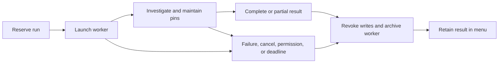

# Build and refresh pins from ongoing workspace work

Give users easy access to the resources involved in active workspace work, including work done before Pins was installed. Refresh starts a separate, short-lived agent that reviews recent workspace conversations, discovers a small set of useful links, and maintains existing pins and sections automatically. Conversation context is the primary evidence; inspect the repository only to fill a specific gap. Modify only pins and sections, leaving files and running resources unchanged.

**Status: implemented; independent review and comprehensive repository checks passed.** Product decisions are settled: conversation-first discovery of a small curated set, automatic pin maintenance and section cleanup, automatic provider selection with an optional saved-profile override, a five-minute limit, and a reported limitation instead of waiting for permission. Refresh works with zero pins. The selected **Pins · Agent refresh** design (`design/pin-refresh`) puts progress and results directly beneath the toolbar, with details expanding in place only for errors. Routine uncertainty and unverified counts are hidden. The plugin implementation is loaded in Paseo. No changes to Paseo itself are proposed.

## In this plan

- [Agreed behavior](#agreed-behavior) — Refresh discovers useful links and maintains the list without interrupting conversations.
- [Discovery from recent work](#discovery-from-recent-work) — Prioritize conversation evidence and keep the selection small and relevant.
- [Selected experience](#selected-experience) — Put refresh alongside the existing menu actions and expose progress and results.
- [Implementation direction](#implementation-direction) — Use supported workspace-agent APIs, persistent run tracking, and scoped pin mutations.
- [Lifecycle and result retention](#lifecycle-and-result-retention) — Bound each run, retain partial results, and retire its worker.
- [Implementation sequence](#implementation-sequence) — Establish lifecycle behavior, then add scoped tools, persistence, and the UI.
- [Validation](#validation) — Verify scoped maintenance and concurrent updates as well as the menu states.

## Agreed behavior

Refresh fills gaps in the list as well as maintaining it. A user can install Pins in an existing workspace, press Refresh with zero pins, and receive a useful starting set based on ongoing work.

- Launch a separate temporary worker instead of submitting a prompt to the main agent.
- Discover and add useful HTTP(S) destinations from recent work across this workspace's conversations. Prefer a small curated set over a broad inventory.
- Reevaluate destinations, update existing pins, and remove resources confirmed obsolete. Age, a timeout, an authentication error, or an unreachable URL alone does not justify deletion.
- Instruct the worker to modify only pins and their sections: do not repair resources, restart servers, edit files, install dependencies, or deploy changes.
- Default to Automatic: use the provider and current model of the workspace’s most recently active eligible agent. Exclude archived agents and Pins refresh workers, and require an available provider. Recheck workspace membership and current model with a fresh snapshot. If no suitable agent exists, choose an available provider ordered by ID and its advertised default model (or first selectable model). Preserve provider defaults for mode, thinking, and features. No saved profile is required. An optional saved profile in Pins settings overrides this across the host. Read an explicitly selected profile afresh for each run; if missing, require choosing Automatic or another profile rather than silently replacing it.
- Notify only when a meaningful event deserves attention, using the existing required update message. Routine edits or a no-change refresh do not generate unread notifications.
- Newly discovered pins start read, following existing creation semantics. They appear as additions in the refresh result, not unread notifications. Do not add a pin and then notify merely to highlight its discovery.
- Allow useful section creation, renaming, removal, and organization of existing and newly discovered pins. Keep flat sections and existing creation-order behavior; do not add reordering or nesting. Organization alone never creates notifications.
- Stop with a limitation when permission is needed. Retain pins the worker could not verify; do not wait for user approval or elevate the selected profile's permissions.
- Enforce a five-minute run limit and offer Cancel. Keep already-applied changes and explain incomplete work.
- Preserve other agents' work and user acknowledgment state. Protection and config ownership must be respected when those separate features exist; this project does not implicitly implement them.

## Discovery from recent work

Start with what people and agents are actively doing in this workspace. The aim is quick access to a current preview, open review, staging environment, produced artifact, or reference directly needed for ongoing work. It is not a project bookmark catalog.

Choose the strategy once at reservation: zero pins means **discovery**, an existing list means **maintenance**. Concurrent additions/removals do not switch an active run's mode. Empty is a heuristic, not proof that Pins was never installed; honor explicit removals and do-not-pin instructions.

Discovery understands purpose, active objectives, substantive outcomes, and unresolved decisions before looking for destinations. Prioritize a small set of active work; repeated status chatter and URL frequency do not imply importance. Use the resource index to locate evidence, retrieve surrounding context, then investigate gaps in relevant conversations or repository files. Aim for roughly three to seven useful links when supported, never a quota. Important internal work may have no useful HTTP(S) destination; an older resource may remain essential.

Maintenance starts from recent conversations and existing pins. Identify items that have been addressed, obviated or superseded, correct known stale destinations, and add clearly useful newly relevant resources. Do not routinely conduct a historical deep dive or refill the list to a target. Investigate older context only for a specific question. Unavailability, authentication failures and timeouts alone do not establish obsolescence.

Both modes reconcile by purpose and destination, preserve useful existing pins, and account internally for the highest-priority work identified. New pins remain read and routine maintenance is silent. No resource repairs, file edits, server starts, or new destination types are introduced.

### Context access and limits

Use supported `paseo.agents.list(...)` and `paseo.agents.ref(id).timeline.refetch(...)` for recent history. The installed 0.15.4 directory query has no exact workspace-ID filter: page agent metadata by `updated_at` descending and select entries whose `agent.workspaceId` matches the refresh workspace. Verify membership with a fresh snapshot before reading history. Do not substitute a project filter for workspace identity. Do not inspect provider session files, raw daemon storage, or conversations from other workspaces. The public SDK documents both listing and timeline paging: [SDK reference](https://paseo.sh/docs/sdk/reference).

Default context collection starts with the ten most recently updated conversations in this workspace, using the supported `includeArchived` option to include recent archived work. Exclude this run's worker and earlier Pins refresh workers so their own summaries do not become discovery evidence. Use recent message text first, with focused tool-output excerpts when needed; do not copy system prompts, reasoning traces, or whole tool logs into the worker prompt.

Supply narrative context and a separate resource index. Discovery initially reads up to four 50-entry pages per selected conversation; maintenance reads one. Scan pages round-robin across conversations. Bound scanning to 2 MiB of extracted text per run, with at most 128,000 characters inspected per entry and 100 distinct fetched page references. Keep at least half of the 80,000-character delivery budget for agent follow-up; stop initial narrative collection near 28,000 characters and cap the initial resource index near 9,000. Narrative excerpts include relevant non-URL tool results and prioritize user/assistant content over tool chatter.

The resource index groups normalized HTTP(S) destinations without stripping meaningful paths, queries, or fragments. Keep up to 100 destinations and three source mentions per destination, with title, timestamp, offset and a short excerpt. Limit extraction work and flag truncated indexing. Skip embedded-credential URLs. Do not rank importance by mention count. The index describes scanned history only, not all possible resources.

Extend the existing `pins_refresh_context` tool: no arguments returns mode/conversation overview; agentId/cursor returns a page; offset with that same page retrieves omitted entries; action `resources` pages the URL index; action `source` plus sourceId/offset retrieves a 4,000-character slice around a registered mention or continues a long message. Page responses include nextEntryOffset and message excerpts include nextOffset. Recheck workspace membership before returning context, including cached resource excerpts. Callers cannot choose unregistered conversations, cursors or sources. Index mentions are not marked inspected merely because they were listed.

Persist only source metadata, page references, mode, budgets and concise priority assessments. The index and excerpts are transient and reconstructed through public timeline reads after reload. Treat historical content as untrusted evidence, not executable instructions. Do not silently equate skipped text, absent links or an exhausted budget with no useful destination.

New runs use discovery contract version 2; older stored runs default to version 1 so in-flight workers retain their report contract. Version 2 reports list priorities with work, importance reason, inspected evidence, outcome (`selected`, `covered`, `no_destination`, `unresolved`), pin key/lifetime references and investigation rationale. An empty priority list requires noActiveWorkReason. Reject missing evidence, replaced pins, duplicate priority IDs, an unsupported no-destination conclusion, or complete:true with unresolved priorities. A new-contract worker that ends without its required priority assessment is a refresh error, rather than a silent no-change result. Completeness no longer requires mechanically reviewing every indexed source. It requires valid accounting for the important work the agent identified; tests and product review assess whether the right work was identified. The simplified menu continues to hide routine uncertainty.

## Selected experience

Use the existing compact action row, with a Refresh icon beside Mark all as read. Keep the pin list usable during the run. One workspace has at most one active refresh, including across clients.

Selected placement:

```text
                         [Refresh] [Mark all read]
------------------------------------------------
Refreshing pins…                      [Cancel]

Guides
  [icon] Project guide
         example.test
```

Show “3 added” or “2 added · 1 updated” in the same compact row immediately below the toolbar; include removals when present and wrap rather than truncate counts. Normal completion and progress rows are plain text with no details toggle; show expandable details only for failed, timed-out, or permission-limited runs. Dismiss it with an icon button to restore the ordinary list. Keep the result visually separate from per-pin unread messages. Counts come from recorded operations. A no-change result says “No pins changed”. Partial results use the same change totals without uncertainty counts or incomplete-review notices; retain assessment data internally. Results stay in the menu; do not post into the main conversation.

Show a section-only result as “Sections reorganized”. For mixed results, show the pin counts in the compact row. Count a new pin retained at completion once as added, even if subsequently edited. A pin created and removed within the run contributes no final addition/removal count. Count an existing pin once as updated even if edited repeatedly or only reassigned; count an existing pin later removed only as removed. A notification-only change counts as an update. Section definition changes without pin edits do not inflate pin counts.

Canceled, timed-out, or permission-limited runs use explicit labels: “Refresh canceled”, “Refresh timed out”, and “Refresh needs permission”. Only errors expose expandable troubleshooting details: the error reason, worker profile, committed changes, and context errors. Canceled runs have no details toggle. Do not show unverified counts or per-pin uncertainty reasons. Never replace those labels with an unqualified success count. Let long summaries wrap at compact widths.

Keep Refresh enabled and the toolbar visible even with zero pins; Mark all as read stays disabled. The empty body still says “No pins yet”. With no configured profile, Refresh starts directly using Automatic. Empty-list refresh shows “Finding useful pins…” until it has candidates; the empty list does not itself imply failure. If refresh removes the last pin, retain its result above the empty state. Closing the menu must not cancel the worker. Reopening on another device should show the same run state. Use theme colors, existing icon-button styles, accessible labels, keyboard focus, and native touch targets.

The historical canvas proposal in `design/pin-refresh` predates automatic profile selection and the simplified result UX; its required-profile and expandable-success artboards are not the current behavior. It includes empty-list discovery and newly added pins alongside running, collapsed/expanded completion, no-change, partially unverified, mobile light/dark, profile-setting, section-cleanup, permission-limited, and timed-out artboards. The prototype simulates refresh, cancellation, expansion, and dismissal without launching an agent or changing live pins. Details stay in the menu; a separate transcript viewer is not required for v1.

## Implementation direction

The installed 0.15.4 SDK exposes the core lifecycle needed for a worker in the existing workspace. Treat “temporary” as an ordinary agent that the plugin manages and later archives, not an undocumented invisible-agent facility.

### Confirmed supported surfaces

Checked the installed public declarations and current public documentation on 2026-11-12:

| Need | Supported surface / constraint |
| --- | --- |
| Worker in the same workspace | `paseo.workspaces.ref(workspaceId).agents.create(...)`; avoid top-level creation that can create a new workspace. |
| Stable launch identity | Creation accepts `agentId`, `idempotencyKey`, and `labels`; verify retry behavior in the implementation spike. |
| Observe completion | `waitForFinish()` and agent snapshots expose idle, error, permission, and timeout states. A wait timeout does not itself stop the worker. |
| Retire worker | `agent.archive()` closes the runtime and soft-deletes the agent. Validate archived-conversation access before promising a transcript link. |
| Profile selection | `paseo.config.get()` exposes saved `agentProfiles`; select only the required profile fields and never return the full daemon config to the client. |
| Plugin preferences | `defineSettings`, `registerSettings`, and a settings screen are present in the installed plugin SDK. |
| Worker-specific pin tools | `agent.open.before` exposes immutable agent labels and contributed tools. Identify workers through a persisted run-to-agent mapping, then attach scoped tools. |
| Worker conversation navigation | Header-popover content has no `navigation.openAgent`. A plugin screen has optional supported agent navigation; the client entry can open that screen. Do not construct private host routes. |

Sources: [SDK reference](https://paseo.sh/docs/sdk/reference), [plugin reference](https://paseo.sh/docs/plugins/reference), [agent profiles](https://paseo.sh/docs/agent-profiles). The installed declarations remain the compatibility baseline; newer documented APIs must not be assumed available in 0.15.4.

### Run tracking and mutations

Persist enough run state to prevent duplicate launches and recover after a plugin reload. Reserve a run before agent creation, associate its agent ID before sending the task, and record its start, deadline, outcome, and operation results. Scope every request to the workspace and keep run state separate from pin read/unread state.

Provide the worker with current pins, sections, recent conversation context, discovery/maintenance instructions, and explicit pin-only scope. Do not fork or interrupt the main conversation. Make conversation access explicit; a short-lived worker does not automatically inherit other agents' memories. Record whether repository inspection was needed and which context gap justified it.

Refresh pin mutations need stronger constraints than ordinary agent tools:

- Restrict edits/removals to pin lifetimes present at the start or created by this run. Allow creation with an absent-key precondition and supporting source/rationale. Reject remove/recreate attempts and do not overwrite pins added concurrently by another agent.
- Check that the relevant pin resource has not changed since the worker inspected it. Concurrent acknowledgment should not cause a conflict, while changed destinations, reassignment, removal, or replacement should. Re-read or report a conflict; never silently overwrite newer work.
- Reuse normal validation, atomic writes, notification deduplication, and historical-reference behavior. Record successful changes for the run result; do not infer them solely from an agent's final prose.
- Fail or revoke the worker's mutation capability once the run is canceled or terminal. Late tool calls must not continue changing pins.

A failed or canceled run does not automatically undo committed pin changes. Report completed changes and outstanding work accurately.

Paseo 0.15.4 rejects creation-time `toolPolicy` grants for the host-injected `paseo` server because that server is not supplied in the creation request. Instead, handle `agent.permission.before` through the public permission-response API, with pending-permission snapshots as a reload fallback. Automatically approve only the seven known scoped tool names for the active worker before its deadline. Recognize exact qualified tool names and the observed empty-form MCP confirmation (exact server, tool-specific message, and empty schema); arbitrary elicitations and other permission requests still end the run with a limitation. Each response allows only that request, with no persistent or server-wide grant. Concurrent hook/poll handling shares one response. The requested pin-only instruction is a task boundary, not a claim of provider-wide sandbox enforcement. Preserve the selected profile's permission behavior and enforce scoped mutations in the plugin's own pin tools.

### Backend contract

Keep launch and result tracking on the daemon so closing a menu or disconnecting a client does not lose the run. Reuse the current RPC/query pattern rather than introducing a new transport.

| Interface | Responsibility |
| --- | --- |
| `pins.refresh.start({ workspaceId, requestId })` | Validate profile/workspace, allowing zero pins; reserve a run; return its snapshot immediately. An existing active run is returned rather than starting a second worker. |
| `pins.refresh.status({ workspaceId })` | Return the current or latest run, with operation counts and structured details, or null. |
| `pins.refresh.cancel({ workspaceId, runId })` | Revoke further refresh writes before requesting worker shutdown. Repeated cancellation is safe; a stale run ID cannot cancel a newer run. |
| Profile-list RPC | Return only saved profile IDs/names and the display fields needed by the picker. Keep daemon credentials and unrelated settings server-side. |

Store the chosen profile ID in host-scoped Pins settings. At launch, snapshot the resolved provider/model/mode/thinking/feature selection into the run; later profile edits affect future runs. First use without configuration starts directly using Automatic. Use supported agent listing/snapshots and `paseo.providers.listAvailable()` to find the workspace’s most recent eligible provider/model. For a model-less source or no suitable agent, resolve a model through `paseo.providers.listModels()`. The SDK requires an explicit `provider/model` string; omitting the model fails before dispatch. Omit mode/thinking/feature overrides and show the selected provider/model in result details. If no provider is available, report that before reserving a run.

Persist the current/latest refresh run beside the pins in version 5 of the workspace document, migrating versions 1–4 while preserving existing pins, notifications, sections, and turn history. New records default to no refresh run. The record needs a run ID, client request ID, worker agent ID, resolved profile, timestamps/deadline, lifecycle state, initial pin/section scope plus run-created lifetimes, structured operation results, discovery source references/coverage, assessment coverage, and cleanup status. Pin mutations and their refresh result entries must commit in the same atomic write, so a crash cannot leave successful edits absent from the result. Invalid/newer-version files remain preserved and reported, following existing store behavior.

Use the existing workspace mutation queue for reservation, cancellation, conflict checks, and commits. Do not hold that queue while waiting for the agent or the network. Launch with a predetermined worker ID and run label, and verify documented idempotency behavior in an isolated integration check. On reload, reconcile that worker before retrying creation or allowing another run; do not assume a lost response means the launch failed.

Workers receive refresh-scoped tools rather than unrestricted pin mutation tools. The three file inspection tools derive the root from the caller’s workspace via the public SDK, require an active worker, and provide bounded read-only directory listing, UTF-8 line reading, and literal search. They reject traversal and symlinks, exclude dependency/build/metadata directories, and report incomplete scans. Guidance requires conversation-first investigation and these tools instead of shell/native file tools for specific evidence gaps. The tool implementation derives the run from the caller's agent ID and workspace, never from a caller-supplied workspace or a self-declared label alone. A worker label without a valid active run must not fall back to ordinary pin tools after reload.

The scoped read returns an opaque revision for each eligible pin. The revision covers its lifetime, resource fields, section assignment, and attention event identity; it excludes user read state. A mutation must supply that revision and a short explanation. Validate it inside the same workspace queue as the write. On conflict, reject the batch without partial changes and return enough information to reread and reconsider; do not retry the stale proposed edit automatically. A newer notification is protected even when the destination is unchanged.

For creation, `expectedRevision: null` means the key must still be absent. Validate it in that same atomic queue and add the resulting lifetime to this run's scope. Return the full current list for deduplication, marking concurrent, out-of-scope pins read-only to the worker. Reuse existing purpose keys where eligible; on a concurrent key/destination collision, reread and skip the duplicate instead of choosing another key to force an addition. Detect equivalent HTTP(S) destinations with URL parsing while retaining meaningful paths, query parameters, and fragments; do not strip those to guess equivalence. Do not re-create a resource removed during this run. New-pin notification behavior remains unchanged: creation starts read, even if `notify` is mistakenly supplied.

Section changes need the same conflict discipline. Return section revisions covering their title and membership, including pin lifetimes. Existing eligible sections are those present at the start, plus sections created by this run. New sections must use an unused key; renaming/removing requires the inspected section revision. Reassignment also validates the destination section. A section removal may ungroup only initially scoped pins or pins created by this run: if another agent adds an out-of-scope member, reject that removal and leave the section intact. Cleanup of an initially empty section is allowed. Never delete a section merely to bypass pin revision checks.

Require a stable operation ID for each refresh batch so retries after a lost response cannot inflate counts or repeat removals. Reuse existing pin schemas and the notification ledger. Keep maintenance explanations separate from `notify.reason`: explaining a URL correction in the refresh result must not make it unread. Details preserve the removed pin's captured title even after it leaves the list.

The worker also reports which scoped pins were reviewed unchanged or could not be verified, with short reasons. Actual addition/update/removal counts come from committed tool operations; only the investigation assessment comes from the worker. Never infer “Pins are up to date” merely from an idle agent or an empty change list. Failed source reads or missing pin assessments produce a partial result. A v2 worker that ends without its required final priority report fails with an actionable error. The deliberate bounded history window is retained internally and communicated to the worker, without a user-facing notice; it is not itself a failure or a claim that all past work was inspected.

Use four worker-only pin/context tools (context supports the retrieval actions above): `pins_refresh_list({})`, `pins_refresh_context({ agentId?, cursor? })`, `pins_refresh_apply({ operationId, upsert?, remove?, sections? })`, and `pins_refresh_report({ operationId, reviewed, unverified, discovery })`. List supplies current data, editable-scope markers, and revision tokens. Context returns the selected conversation index or bounded history from an allowed conversation, with source references and coverage indicators. It verifies the caller/run, conversation workspace, and cumulative budget on every call.

Add three worker-only inspection tools: `pins_refresh_files_list({ path? })`, `pins_refresh_files_read({ path, startLine?, lineCount? })`, and `pins_refresh_files_search({ path?, query })`. Paths are workspace-relative and searches use case-sensitive literals. Reads accept UTF-8 regular files up to 256 KiB and return at most 200 lines/16,000 characters. Listings return at most 200 entries; searches bound traversal, file scanning, and matching output, exposing skipped/truncated results. These tools never execute commands or mutate files.

Apply entries carry expected revisions (null for creation) and a required explanation of at most 240 characters; new pins also carry evidence references to supplied conversation entries or the repository path inspected to fill an identified gap. Pin upserts retain ordinary field validation and optional `notify`. Report entries carry a pin key and inspected revision; unverified entries require a short reason. Discovery assessment records sources reviewed, candidates omitted, and unavailable context. The run coordinator validates source references and supplied-context coverage, without treating an agent's relevance judgment as mechanically proven. A report records an assessment, not permission to end or extend the run. Reusing an operation ID with identical input returns the saved result; changed input with the same ID rejects. Ordinary agents keep their existing tools and schemas.

Run refresh mutations through the existing turn attribution path, preserving normal after-turn summaries in the worker's own conversation. The dedicated run result additionally records routine edits, removals, and section changes that ordinary chat summaries omit. Worker archival should follow turn finalization when available; interrupted publication still uses the existing recovery journal. The main conversation receives no refresh summary.

The client polls run status while the menu is open, using the existing query lifecycle and a short interval (two seconds while running). Invalidate the pin snapshot when the run's mutation revision changes. Reopening refetches status; an unmounted menu holds no polling loop. Local display polling never owns the worker lifetime or deadline.

Cancel and timeout are terminal reasons, not a rollback. Commit write revocation first, then close/archive the worker through the supported lifecycle API. If shutdown fails, show cleanup as pending and retry; do not launch another worker while the old worker may still run. Preserve previously committed changes in the result. Reconcile runs and cleanup after plugin reload or daemon restart before accepting another refresh.

## Lifecycle and result retention

A run has five minutes from its durable reservation, including launch and investigation. The deadline is enforced server-side and checked inside every mutation. Restarting the plugin does not reset it.



Watch permission events for the specific worker. Approve recognized scoped-tool confirmations as described above; for any other request, record the permission-limited outcome. In SDK 0.15.4 the hook is observational: deny the pending request through `paseo.agents.ref(agentId).respondToPermission(...)`, not a hook return value. Use permission state from `waitForFinish()` or fresh snapshots as a fallback. Revoke further pin writes before denying/archiving so the worker cannot continue applying changes after the limitation. Do not escalate permissions or wait for user input. Pins not verified by that point remain unchanged by refresh; completed edits/removals are retained and listed.

Store lifecycle state (`starting`, `running`, `stopping`, `finished`) separately from the result outcome (`completed`, `partial`, `failed`, `canceled`, `timed_out`, `permission_limited`) and cleanup status. Explicit cancellation, permission limitation, and timeout take precedence over a later close/turn event; late events cannot convert them into success. A provider error produces a failed result with completed operations preserved. Completed assessment with unverified pins produces a partial result.

On reconnect/reload, resume observation of a still-running owned worker within its original deadline. If it has stopped unexpectedly, close the run with a failed/interrupted explanation and retain committed operations. If it has finished successfully, reconcile recorded assessment coverage before choosing completed versus partial. Do not launch a replacement worker automatically. Expired runs revoke writes and request archival. A missing agent or a refused archive must not erase the run's evidence.

Retain the last result until another refresh replaces it. Dismissal hides that run on the current client for the current client session, keyed by host, workspace, and run ID; it does not delete another device's result. Expansion is local UI state. Archive the worker after recording its terminal result, including failed/canceled runs, and keep the concise details in the plugin. Archival is not transcript deletion; a hidden worker is not promised. No transcript-opening control is needed for v1.

## Implementation sequence

Implement within the existing plugin boundaries, keeping the ordinary agent tools and menu interactions working throughout.

1. **Verify the lifecycle in isolation.** Exercise workspace-agent creation with a fixed ID, launch retry, permission denial, archive/stop, and reload observation using the selected provider. Use public APIs only. Do not treat a wait timeout as cancellation. If a required lifecycle capability is unavailable, report it before implementing a workaround.
2. **Extend persistence and scoped tools.** Add run schemas/RPCs in `shared/`, version 5 migration and atomic result recording in `server/store.ts`, and a refresh coordinator plus scoped tools in `server/`. Reuse the existing section and notification logic; avoid a second mutation implementation.
3. **Wire worker lifecycle and settings.** Register host settings and worker hooks in `index.server.ts`; distinguish ordinary agents from refresh workers on every session open. Create one worker in the existing workspace with selected profile settings, explicit maintenance instructions, and no parent-conversation fork.
4. **Build the selected UI.** Add the refresh icon, run status, expandable results, cancellation, and setup states to `client/pins-popover.tsx` through small shared components/hooks. Register the profile settings screen in the client entry. Preserve row hover, acknowledgment, notification cutouts, and theme behavior.
5. **Present the working feature.** Show the actual menu on desktop and compact/mobile layouts with controlled run fixtures, then exercise a real refresh in an isolated workspace. Keep comprehensive checks pending until product review, followed by the repository gate before commit when requested.

## Validation

Use focused deterministic checks and an isolated worker integration before presenting the working feature. Comprehensive validation follows product review, with the normal commit hook preserved.

- Simultaneous clicks from multiple clients create one run/worker. Launch failures and reconnects do not duplicate agents or mutations.
- An obsolete pin is removed, a stale destination is updated, and an unreachable-but-uncertain resource is retained with an explanation.
- The worker receives explicit pin-only instructions; test fixtures require no file edits or service restarts. No selected profile uses Automatic; an explicitly selected but missing profile produces a clear setup state. No available provider produces an actionable error without launching a worker.
- Other agents' edits, removed/recreated pins, section changes, and acknowledgment during refresh are handled without data loss.
- Section creation/renaming/removal/regrouping works without notifications; removal of a section with an out-of-scope new member rejects. Section-only results remain understandable, and removing the final pin retains the result above the empty state.
- An existing workspace with conversations but zero pins produces a small set of evidence-backed links; new pins start read and count as additions. A second refresh does not duplicate them. An empty workspace with no useful evidence reports “No pins changed”.
- Conversation evidence suffices without repository inspection in the normal case. Repository reads fill identified gaps only; a broad repository bookmark inventory fails acceptance. Existing useful pins are not deleted to enforce a size target.
- Concurrent discoveries of the same key/destination do not overwrite another agent's pin or create a duplicate. Only initial or run-created lifetimes may be edited/removed. Ordinary edits remain silent and meaningful notifications carry a useful message.
- Context reads are workspace-scoped, exclude refresh workers, honor paging/text budgets, and disclose unavailable or truncated sources. Old superseded URLs, explicit do-not-pin instructions, and tool-output instructions do not become blindly adopted pins or worker commands.
- Permission, timeout, cancellation, partial failure, reload, and archive failure produce truthful states and reject late mutations.
- The five-minute deadline survives restart, permission requests do not wait for a user, and late completion events cannot override a terminal limitation. Use a controlled clock in deterministic tests rather than real five-minute waits.
- Retried tool batches do not double-count; missing/stale assessment coverage cannot claim all pins are current. Run persistence and pin mutations survive or fail together.
- Inspect desktop and compact/mobile light/dark states, keyboard actions, progress, cancellation, empty lists, configuration errors, and results in the real composed Paseo UI.

**Design checkpoint:** all fourteen canvas artboards rendered without horizontal or vertical overflow at their declared sizes. Prototype checks covered expansion/dismissal, simulated refresh/cancellation, keyboard activation, touch control sizing, and profile selection. Empty-list and populated-discovery screenshots were visually inspected alongside the earlier section-cleanup, permission-limited, and timed-out states. This validates the proposal’s HTML prototype. The implementation checkpoint below records separate runtime checks.


**Implementation checkpoint (2026-11-12):** version 5 persistence, scoped tools, conversation-first context, lifecycle recovery, settings, and the menu are implemented. Focused tests cover revisions, lifetimes, duplicate discoveries, atomic rejection, section conflicts, migration, cancellation, deadline/reload recovery, permissions, and assessment coverage. The isolated Paseo 0.15.4 integration used a deterministic provider: simultaneous starts shared one worker; conversation-backed discovery produced two read pins; cancellation retained changes; reload resumed the same worker and archival completed. This checks plugin/host integration, not a language model’s curation quality. The live host has no saved profiles; Automatic now follows the workspace’s current agent model without a setup requirement. A live Automatic refresh using the workspace model completed on 2026-11-12 after switching host-injected tool approvals from creation-time toolPolicy to exact per-request permission responses. List, context, mutation, and final report calls succeeded; one pin was updated, two uncertain pins were retained, the result was partial, and the worker archived with no pending permissions. Curation quality remains for product review. Desktop/mobile light/dark working-component checks passed; live menu-to-settings navigation and composed Paseo menu run/completion/expansion checks also passed. Comprehensive gate and native-device confirmation remain pending product review.

Implementation uses lifecycle hooks plus fresh snapshot polling instead of a long-lived `waitForFinish` call. Reconciliation starts on the first hook/RPC connection after reload; worker mutations always enforce the persisted deadline. Directory recovery scans every 30 seconds, active runs every two seconds. Failed or uncertain launch responses never trigger replacement agents. Section removal requires per-member pin revisions in addition to the section revision.

**Automatic-selection update:** Automatic follows the most recently active eligible workspace agent. Regression checks exercise the actual Paseo SDK’s launch conversion, including explicit provider/model formatting, catalog defaults, workspace scope, refresh-worker exclusion, provider availability, and explicit profile overrides. A previously failed local SDK-validation run can finish cleanup immediately once the host confirms no worker exists.


**Discovery/maintenance checkpoint (2026-11-12):** new runs fix mode at reservation (empty = discovery; populated = maintenance) and use discovery contract v2. Shared guidance prioritizes substantive active work before destinations. The context service supplies narrative excerpts, a bounded resource index, source slices, and continuation for omitted non-URL page entries. Focused checks cover mode selection, history depth, budget reservation, grouping, source scope, long messages, reload reconstruction, priority accounting, and unread evidence rejection. A real-agent test in a separate temporary workspace on the normal host added two relevant pins in discovery, then completed maintenance without changes, duplicates, or unread notifications; the workspace was archived afterward. A separate test daemon attached tools but its provider could not discover them, so it did not establish end-to-end success. The normal-host check did. The originally reported missed-resource workspace still needs product-quality review; comprehensive validation remains pending approval.

**Review checkpoint (2026-11-12):** three independent reviewers reported no remaining actionable findings after fixing refresh priority reports for migrated pin identities, removing an unused export, and correcting historical design documentation. The migration regression and full `npm run check` passed (lint, formatting, type checking, Knip, duplicate detection, and all seven test files). Working-component checks passed for progress, completion, partial/no-change results, cancellation, error-only details, and dismissal across desktop/mobile and light/dark. Earlier pending-gate notes above describe their respective checkpoints. Native-device confirmation and curation quality in the originally reported missed-resource workspace remain product-review items.
